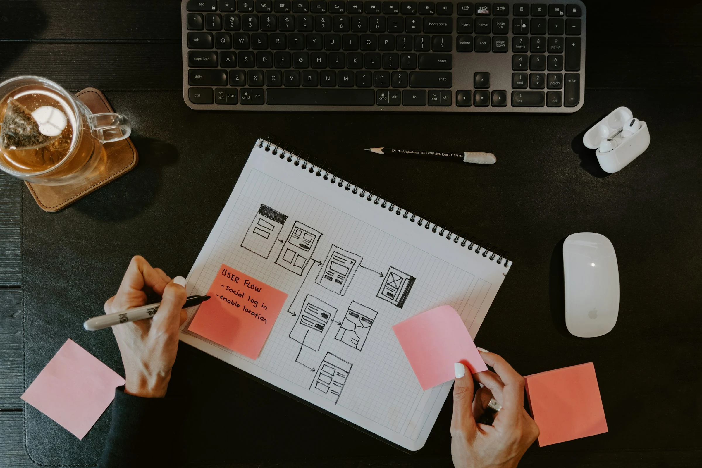
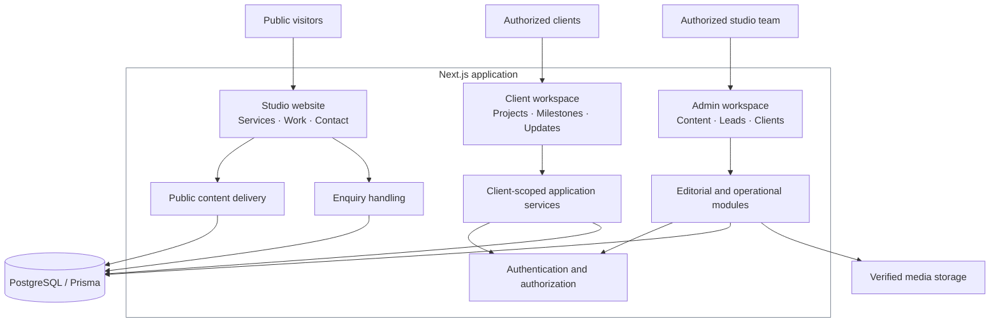

<p align="center">
  <picture>
    <source media="(prefers-color-scheme: dark)" srcset="./public/branding/valtum-horizontal-white.svg">
    
  </picture>
</p>

<h1 align="center">Good ideas. Beautifully built.</h1>

<p align="center">
  An independent Australian software and digital product studio bringing thoughtful design, creative technology and considered engineering together.
</p>

<p align="center">
  <a href="https://valtumstudio.com.au/">Website</a> ·
  <a href="https://valtumstudio.com.au/work">Selected work</a> ·
  <a href="https://valtumstudio.com.au/services">Capabilities</a> ·
  <a href="https://valtumstudio.com.au/contact">Contact</a>
</p>

---

## The studio behind the work

A digital product should do more than look impressive. It should make a complex task feel simple, give people confidence in the decisions they make and remain dependable when the experience becomes demanding.

Valtum Studio works across custom software, web and application development, user experience, AI-enabled systems and creative development. The studio's approach connects the business problem to the interface and the engineering that supports it.

This repository brings that thinking into one codebase: the public studio experience, its structured content platform, enquiry workflows and protected operational workspaces.

<p align="center">
  
</p>

## One platform. Different responsibilities.

| Experience | Purpose |
| :--- | :--- |
| **Public studio** | A design-led introduction to the studio, its capabilities, approach and project work. |
| **Selected work** | Editorial case studies connecting product decisions to interface design and supporting systems. |
| **Content operations** | Structured services, projects, insights and media, with controlled editorial publication. |
| **Enquiries** | Lead capture and internal project qualification workflows. |
| **Administration** | Protected management of content, operational records and authorized users. |
| **Client workspace** | A separate project-facing experience for progress, milestones, updates and issued invoices. |

The public experience and the protected workspaces share foundations without sharing permissions. The repository contains the application code for these surfaces; deployment and authorized access are managed separately.

### Experience principles

**Clarity over complexity.** Information architecture and interaction should help someone understand what matters next.

**Motion with a purpose.** Creative transitions can establish rhythm and character on the public website. Operational dashboards prioritize stillness, readability and quick decisions.

**Design and engineering together.** Typography, accessibility, responsive behavior, structured content and reliable data flows are parts of the same product.

**Real information, carefully presented.** Private experiences are designed around persisted records, role-specific access and auditable changes, not fabricated demo metrics.

## System architecture

Valtum Studio is organized as a modular Next.js application. Public presentation, internal workflows and client-facing data are kept behind separate route and authorization boundaries.



*Conceptual overview of the repository's application boundaries; infrastructure configuration varies by environment.*

### Engineering stack

| Layer | Technology |
| :--- | :--- |
| Application | Next.js App Router, React, TypeScript |
| Interface | Tailwind CSS, GSAP, Lenis, modular UI components |
| Data | PostgreSQL, Prisma |
| Identity | Better Auth, permission-based protected routes |
| Editorial tooling | Lexical and structured content modules |
| Media | S3-compatible object storage integration |
| Validation | Zod |
| Quality | ESLint, TypeScript, Vitest, Playwright |
| Delivery | Container tooling and deployment configuration |

## Explore the codebase

```text
src/
  app/                  Public, admin, portal and API routes
  modules/
    public-site/        Studio presentation and experience
    public-content/     Published content and SEO delivery
    cms/                Editorial management
    leads/              Enquiries and qualification
    auth/               Identity, sessions and access rules
    admin/              Internal workspace modules
    portal/             Client-scoped workspace modules
  components/           Shared interface building blocks
  server/               Server-side infrastructure

prisma/                  Database schema and migrations
public/                  Studio identity, editorial and project assets
docs/                    Architecture, engineering and operations
e2e/                     Browser-level verification
```

Further reading:

- [Architecture and system boundaries](docs/architecture/README.md)
- [Authentication and authorization](docs/architecture/authentication-and-authorization.md)
- [Structured content architecture](docs/architecture/structured-cms.md)
- [Customer workspace design](docs/operations/customer-portal.md)
- [Engineering standards](docs/engineering/coding-standards.md)
- [Testing approach](docs/engineering/testing-strategy.md)
- [Security policy](SECURITY.md)

## Development

The repository is a full-stack application, not a static website template. Local development requires the configured environment and a PostgreSQL instance.

**Prerequisites:** Node.js `24.18.0`, Corepack / pnpm `11.25.0` and Docker for the documented local database workflow.

```bash
corepack enable
corepack pnpm install --frozen-lockfile

# Copy .env.example to .env.local, then configure local values.
docker compose --env-file .env.local up -d db

corepack pnpm db:generate
corepack pnpm db:migrate
corepack pnpm db:seed
corepack pnpm dev
```

The application is served at [localhost:3000](http://localhost:3000). Never commit real environment variables or credentials. See the [local development guide](docs/operations/local-development.md) and [environment reference](docs/operations/environment-variables.md) before provisioning a new environment.

### Verification

```bash
corepack pnpm check
corepack pnpm test:integration
corepack pnpm build
corepack pnpm test:e2e
```

Database integration tests and browser tests require their respective local services and test configuration. Command definitions in [`package.json`](package.json) are the source of truth.

## A note on the work

This repository is one part of Valtum Studio's broader portfolio. The [work collection](https://valtumstudio.com.au/work) presents the visual and product context; this codebase shows how the studio's own web experience and supporting systems are organized.

**Valtum Studio** · Australia · [valtumstudio.com.au](https://valtumstudio.com.au/) · [Get in touch](https://valtumstudio.com.au/contact)

<sub>Public visibility is not an open-source license. No permission to reuse proprietary source code, branding or project imagery is implied by this README.</sub>
